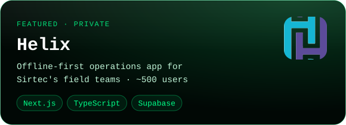
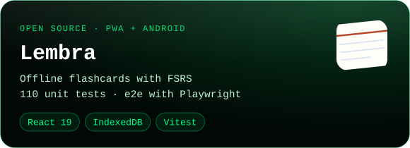
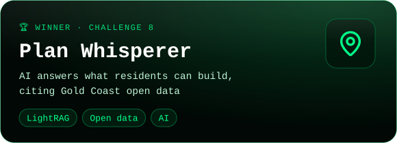
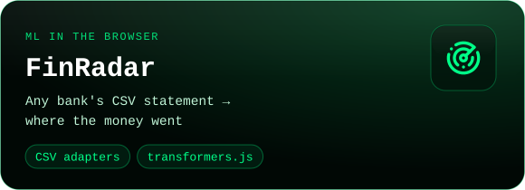

**🇬🇧** Full-stack developer from Southern Brazil, living on the Gold Coast, Australia. At **Sirtec**, an electricity distribution contractor with 4,000+ employees, I went from intern to Full Stack Developer in about 4 months. I started **Helix** and worked across the whole app: an offline-first operations app used by **~500 field workers**. I care about tests, CI/CD and writing decisions down, and I use AI tools every day while reviewing what they produce.

**🇧🇷** Dev full stack, gaúcho, morando em Gold Coast, na Austrália. Na **Sirtec** (distribuidora de energia, 4.000+ funcionários) fui de estagiário a Desenvolvedor Full Stack em cerca de 4 meses. Iniciei o **Helix** e trabalhei no app inteiro: um app offline-first usado por **~500 profissionais de campo**. Aberto a vagas **100% remotas**.

<b>More about each project</b>

- **Helix** (private, built at Sirtec). Start and end times are stored with no signal and synced when the connection returns; managers see each activity in real time; integrated the teams' safety-camera software. React, Next.js, TypeScript, Node.js, Supabase.
- **[Lembra](https://github.com/DottoLeao/lembra)**: offline spaced-repetition flashcards (PWA + Android). React 19 + TypeScript, FSRS scheduling, IndexedDB; a pure domain layer separated from the UI, 110 unit tests (Vitest) plus end-to-end tests (Playwright); GitHub Actions builds the Android app. · [Live](https://lembra-nine.vercel.app)
- **Plan Whisperer**: 🏆 Winner, Challenge 8, Gold Coast Open Data Challenge 2026 (team of 6). AI assistant that uses the city's open data and planning rules to answer what residents can build, citing sources. I worked on the backend (LightRAG service + chat API) and deployment.
- **[FinRadar](https://github.com/DottoLeao/finradar)**: upload any bank's statement CSV and see where the money went. Adapter-based parsers per bank, rules-first categorisation and an optional classifier running entirely in the browser (transformers.js). · [Live](https://finradar-zeta.vercel.app)

  

<picture>
  <source media="(prefers-color-scheme: dark)" srcset="https://raw.githubusercontent.com/DottoLeao/DottoLeao/output/snake-dark.svg"/>
  
</picture>

