### 🇬🇧 Hi, I'm Lorenzo

Full-stack developer from Southern Brazil, living on the Gold Coast, Australia. At **Sirtec**, an electricity distribution contractor with 4,000+ employees, I went from intern to Full Stack Developer in about 4 months. I started **Helix** and worked across the whole app: an offline-first operations app used by **~500 field workers** (React, Next.js, TypeScript, Node.js, Supabase).

I care about tests, CI/CD and writing decisions down, and I use AI tools every day while reviewing what they produce.

### 🇧🇷 Oi, sou o Lorenzo

Dev full stack, gaúcho, morando em Gold Coast, na Austrália. Na **Sirtec** (distribuidora de energia, 4.000+ funcionários) fui de estagiário a Desenvolvedor Full Stack em cerca de 4 meses. Iniciei o **Helix** e trabalhei no app inteiro: um app offline-first usado por **~500 profissionais de campo**. Aberto a vagas **100% remotas**.

---

### Stack

---

### Selected work

**[Lembra](https://github.com/DottoLeao/lembra)** — offline spaced-repetition flashcard app (PWA + Android).
React 19 + TypeScript, FSRS scheduling, IndexedDB; a pure domain layer separated from the UI, **110 unit tests (Vitest)** plus end-to-end tests (Playwright); GitHub Actions builds the Android app. · [Live](https://lembra-nine.vercel.app)

**Helix** (private, built at Sirtec) — field-team operations app used by ~500 field workers. Offline-first: start and end times are stored with no signal and synced when the connection returns; managers see each activity in real time; integrated the teams' safety-camera software.

**Plan Whisperer** — 🏆 **Winner, Challenge 8, Gold Coast Open Data Challenge 2026** (team of 6). AI assistant that uses the city's open data and planning rules to answer what residents can build, citing sources. I worked on the backend (LightRAG service + chat API) and deployment.

**[FinRadar](https://github.com/DottoLeao/finradar)** — upload any bank's statement CSV and see where the money went. Adapter-based parsers per bank, rules-first categorisation and an optional classifier running entirely in the browser (transformers.js). · [Live](https://finradar-zeta.vercel.app)

---

### Contact

<picture>
  <source media="(prefers-color-scheme: dark)" srcset="https://raw.githubusercontent.com/DottoLeao/DottoLeao/output/snake-dark.svg"/>
  
</picture>

